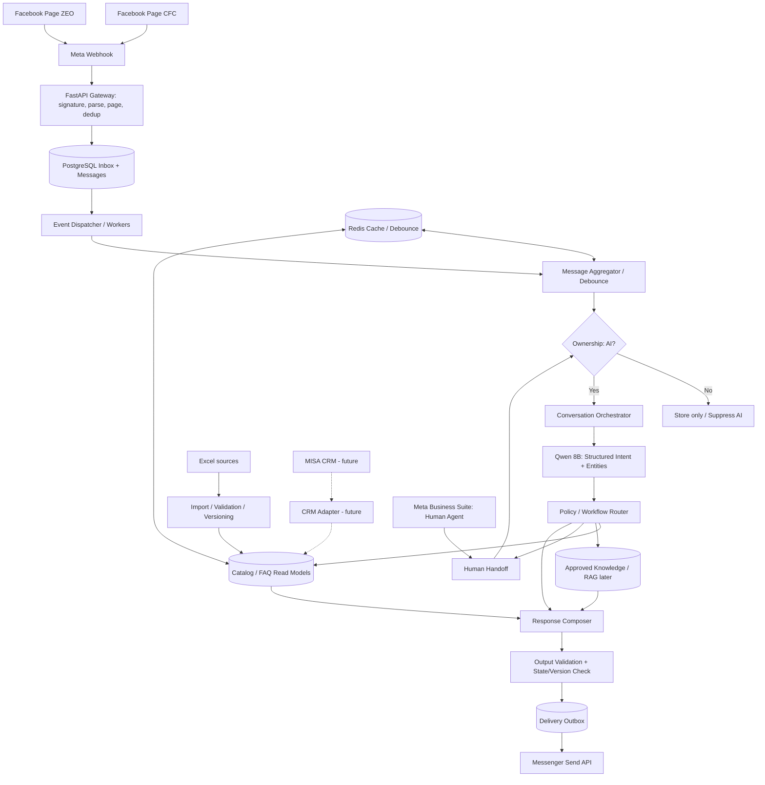
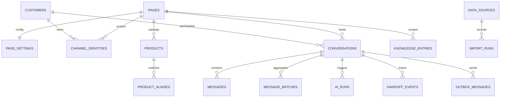
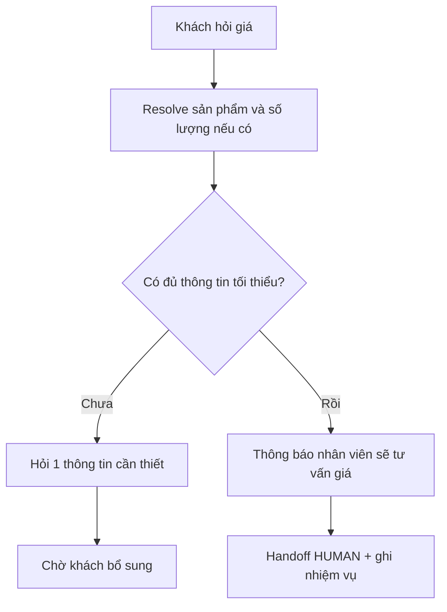

# CFC–ZEO AI CUSTOMER SERVICE PLATFORM
## Architecture & Delivery Plan v1.1 — 24/10/2026

> **Trạng thái:** Baseline để thiết kế chi tiết, lập backlog, triển khai và nghiệm thu. Hệ thống chỉ được bật auto-reply khi tất cả **go-live gate** trong tài liệu này đạt.  
> **Mục tiêu:** Xây lại chatbot Facebook Messenger bằng Python, bỏ n8n khỏi đường chạy production; phục vụ hai Page CFC/ZEO; Ollama Qwen 8B; nhân viên làm việc trên Meta Business Suite; **không tự báo giá**.  
> **Từ khóa quy ước:** **MUST** = bắt buộc; **SHOULD** = nên làm, muốn bỏ phải có ADR; **MAY** = tùy chọn.  
> **Nguyên tắc phát hành:** fail closed với quyền gửi, giá, nội dung rủi ro và dữ liệu chưa duyệt.

---

## 1. Phạm vi và quyết định đã chốt

| Hạng mục | Quyết định |
|---|---|
| Kênh | Facebook Messenger: Page CFC và Page ZEO |
| Backend | Python 3.12+, FastAPI, Modular Monolith theo domain |
| Event processing MVP | PostgreSQL durable inbox/work queue/outbox; worker claim bằng lease và `FOR UPDATE SKIP LOCKED`; không thêm broker trước khi có ADR và số liệu tải |
| Lưu trữ | PostgreSQL nguồn sự thật; Redis không phải nguồn lưu lịch sử duy nhất |
| AI | Ollama với model Qwen 8B hiện có; đo năng lực thực tế trước khi tối ưu |
| Dữ liệu sản phẩm/FAQ | Excel là nguồn nhập; mọi record mặc định `QUARANTINED`, chỉ bản đã duyệt/publish mới được bot sử dụng |
| Page/brand | `page_id` và `brand_id` là hai khái niệm riêng; quyền trả lời/bán/redirect được khai báo bằng `page_brand_scopes` |
| MISA CRM | Để sau; thiết kế adapter và cache interface, không làm dependency cho MVP |
| Giá bán | Không đưa giá vào context sinh câu trả lời; không bịa, suy đoán hoặc đọc giá từ FAQ/listing; mọi `PRICE_INQUIRY` chuyển người |
| Hỏi giá | Tạo handoff task ngay; bot xác nhận và MAY hỏi tối đa một thông tin hữu ích nhưng không được chặn việc chuyển người vì thiếu số điện thoại/khu vực |
| Nhân viên | Meta Business Suite + ops console tối thiểu; phải kiểm chứng event admin/handover trên cả hai Page |
| Giao diện vận hành | Bắt buộc trước auto-reply production: pause/resume/takeover, task queue, lỗi gửi/import, audit và kill switch theo Page |
| Bảo mật | Auth/RBAC/audit, retention, backup/restore, secret rotation và network isolation là baseline trước production, không để sau MVP |
| Triển khai | Docker Compose cho pilot có kiểm soát; HTTPS webhook; secrets ngoài Git; PostgreSQL/Redis/Ollama không public Internet |
| Rollout | Replay test → shadow mode → canary theo Page/workflow → production; có rollback và kill switch |

### Không nằm trong MVP
- Tự động tạo đơn hàng hoặc ghi CRM; tự báo giá; chẩn đoán chắc chắn bệnh cây; fine-tune model; Kubernetes/microservices; tự học từ mọi tin admin.

### Điều kiện tối thiểu để bắt đầu auto-reply pilot

1. Meta spike trên CFC và ZEO chứng minh được cách phân biệt khách, bot echo và nhân viên; nếu không chứng minh được thì ops takeover/pause phải là cơ chế bắt buộc.
2. Webhook có signature verification, dedup và durable write trước ACK.
3. Ownership/version được kiểm tra lại trong cùng transaction quyết định gửi; không chỉ kiểm tra ở đầu workflow.
4. Knowledge đã publish, có Page/brand/audience/risk scope; giá và nội dung nội bộ bị hard-filter.
5. Có handoff task, nơi nhân viên nhận việc, SLA, notification, close/resume và audit.
6. Bộ regression, cross-page leakage, takeover race, backup/restore và rollback đều đạt gate được định nghĩa ở Mục 19–24.

### Nguyên tắc kiến trúc
1. Python quyết định nghiệp vụ, trạng thái và quyền; Qwen hiểu ngôn ngữ và diễn đạt.
2. Mọi truy vấn được giới hạn theo `page_id`; không trộn CFC và ZEO.
3. Chỉ dùng dữ liệu đã xác minh để nêu thông số sản phẩm, địa chỉ, số điện thoại, liều dùng.
4. Mọi event có thể được gửi lặp; xử lý idempotent và có audit trail.
5. Không có giá => `PRICE_INQUIRY` luôn đi theo quy trình chuyển người, không tìm cách tự tính giá.
6. `active=true` ở file nguồn không đồng nghĩa `approved`; dữ liệu chưa publish không được retrieval.
7. Không sao chép raw PII sang Sheet/Telegram/learning queue; chỉ truyền reference hoặc dữ liệu tối thiểu đã mask.
8. Mọi external side effect có idempotency key, attempt log và reconciliation; không retry mù cả workflow.

---

## 2. Sơ đồ kiến trúc tổng thể



**Luồng đồng bộ dữ liệu** tách khỏi luồng chat. Excel là nguồn nhập; PostgreSQL là read model chuẩn hóa; Redis là cache. Không đọc Excel trực tiếp mỗi tin nhắn.

---

## 3. Ranh giới module

| Module | Trách nhiệm | Không chịu trách nhiệm |
|---|---|---|
| `channels` | Webhook, Meta API, event normalization | Quyết định báo giá/tư vấn |
| `aggregation` | Gom tin, lịch debounce, batch version | Tự gọi Ollama |
| `conversations` | State, slots, phiên, ownership | Lưu danh mục sản phẩm |
| `handoff` | Tiếp quản, pause/resume, human event | Dự đoán giá |
| `orchestration` | Điều phối intent → workflow → context → response | Gọi Meta trực tiếp |
| `llm` | Qwen client, structured output, timeouts | Quyền nghiệp vụ |
| `catalog` | SKU, alias, thuộc tính, dữ liệu import | Sáng tác thông tin sản phẩm |
| `knowledge` | FAQ, tài liệu được duyệt, retrieval | Dữ liệu giá/CRM thời gian thực |
| `delivery` | Outbox, retry, final send guard | Tự thay đổi ownership |
| `integrations` | Excel importer, CRM adapter sau này | Luồng hội thoại |
| `evaluation` | Regression, đo lỗi intent, sản phẩm, handoff | Tự đưa thay đổi vào production |

---

## 4. Cây thư mục mục tiêu

```text
cfc-zeo-ai-platform/
├── apps/
│   ├── api/
│   │   ├── main.py
│   │   ├── lifespan.py
│   │   └── dependencies.py
│   ├── worker/
│   │   ├── main.py
│   │   ├── event_worker.py
│   │   ├── aggregation_worker.py
│   │   ├── ai_worker.py
│   │   ├── delivery_worker.py
│   │   └── import_worker.py
│   └── ops-web/                    # Required before auto-reply production
│       └── README.md
├── src/chatbot/
│   ├── core/
│   │   ├── settings.py
│   │   ├── security.py
│   │   ├── logging.py
│   │   ├── exceptions.py
│   │   └── telemetry.py
│   ├── modules/
│   │   ├── channels/
│   │   │   ├── api.py
│   │   │   ├── service.py
│   │   │   ├── schemas.py
│   │   │   └── meta/
│   │   │       ├── webhook.py
│   │   │       ├── signature.py
│   │   │       ├── normalizer.py
│   │   │       ├── send_api.py
│   │   │       └── handover_events.py
│   │   ├── pages/
│   │   │   ├── service.py
│   │   │   ├── models.py
│   │   │   └── repository.py
│   │   ├── customers/
│   │   │   ├── service.py
│   │   │   ├── identity.py
│   │   │   └── repository.py
│   │   ├── conversations/
│   │   │   ├── service.py
│   │   │   ├── state_machine.py
│   │   │   ├── slots.py
│   │   │   └── repository.py
│   │   ├── aggregation/
│   │   │   ├── service.py
│   │   │   ├── debounce.py
│   │   │   └── scheduler.py
│   │   ├── handoff/
│   │   │   ├── service.py
│   │   │   ├── policy.py
│   │   │   └── detection.py
│   │   ├── orchestration/
│   │   │   ├── orchestrator.py
│   │   │   ├── input_analyzer.py
│   │   │   ├── intent_router.py
│   │   │   ├── slot_manager.py
│   │   │   ├── context_builder.py
│   │   │   ├── policy_router.py
│   │   │   ├── response_composer.py
│   │   │   └── output_validator.py
│   │   ├── workflows/
│   │   │   ├── registry.py
│   │   │   ├── price_handoff.py
│   │   │   ├── dealer_lookup.py
│   │   │   ├── product_inquiry.py
│   │   │   ├── agriculture_advice.py
│   │   │   ├── sales_lead.py
│   │   │   └── human_request.py
│   │   ├── catalog/
│   │   │   ├── service.py
│   │   │   ├── product_resolver.py
│   │   │   ├── alias_matcher.py
│   │   │   └── repository.py
│   │   ├── knowledge/
│   │   │   ├── importer.py
│   │   │   ├── retrieval.py
│   │   │   ├── source_policy.py
│   │   │   └── embeddings.py        # Later phase
│   │   ├── memory/
│   │   │   ├── recent_history.py
│   │   │   ├── summary.py
│   │   │   └── user_facts.py
│   │   ├── llm/
│   │   │   ├── provider.py
│   │   │   ├── ollama.py
│   │   │   ├── schemas.py
│   │   │   └── prompts.py
│   │   ├── integrations/
│   │   │   ├── excel/
│   │   │   │   ├── reader.py
│   │   │   │   ├── validator.py
│   │   │   │   ├── mapper.py
│   │   │   │   └── importer.py
│   │   │   └── misa/                # Future; interface only
│   │   │       ├── port.py
│   │   │       └── README.md
│   │   ├── delivery/
│   │   │   ├── service.py
│   │   │   ├── outbox.py
│   │   │   └── retry.py
│   │   └── evaluation/
│   │       ├── datasets.py
│   │       ├── runner.py
│   │       └── metrics.py
│   ├── infrastructure/
│   │   ├── db/
│   │   │   ├── session.py
│   │   │   ├── models/
│   │   │   └── repositories/
│   │   ├── cache/redis.py
│   │   ├── messaging/
│   │   │   ├── inbox.py
│   │   │   ├── outbox.py
│   │   │   └── broker.py
│   │   └── locks/conversation.py
│   └── shared/
│       ├── enums.py
│       ├── events.py
│       └── types.py
├── config/
│   ├── pages/cfc.yaml
│   ├── pages/zeo.yaml
│   ├── prompts/intent.md
│   ├── prompts/response.md
│   ├── prompts/cfc.md
│   ├── prompts/zeo.md
│   ├── policies/handoff.yaml
│   ├── policies/output.yaml
│   ├── policies/agriculture.yaml
│   └── data_sources/excel_mapping.yaml
├── knowledge/
│   ├── cfc/{products,crops,agriculture,faq}/
│   └── zeo/{products,zeolite,detergent,faq}/
├── data/
│   ├── incoming/                   # Excel input; gitignored if sensitive
│   ├── normalized/                 # Validated JSON/Markdown snapshots
│   └── samples/                    # Synthetic demo data
├── migrations/versions/
├── tests/
│   ├── unit/
│   ├── integration/
│   ├── contract/
│   ├── e2e/
│   ├── regression/
│   └── fixtures/
├── scripts/
│   ├── import_excel.py
│   ├── seed_pages.py
│   └── replay_webhook.py
├── docs/
│   ├── architecture.md
│   ├── database.md
│   ├── api-contracts.md
│   ├── event-contracts.md
│   ├── meta-handoff-validation.md
│   └── operations-runbook.md
├── deploy/
│   ├── docker/
│   ├── reverse-proxy/
│   └── monitoring/
├── .github/workflows/ci.yml
├── Dockerfile
├── docker-compose.yml
├── alembic.ini
├── pyproject.toml
├── .env.example
├── .gitignore
└── README.md
```

**Quy tắc:** Không viết tất cả file một lần. Mỗi phase chỉ tạo file cần thiết; tên thư mục thể hiện ownership nghiệp vụ. `data/incoming` không được commit dữ liệu khách hàng hoặc thông tin nội bộ nhạy cảm.

---

## 5. Database schema logic

### 5.1 Bảng cốt lõi MVP

| Bảng | Cột cốt lõi | Ràng buộc |
|---|---|---|
| `pages` | `id`, `meta_page_id`, `code`, `enabled` | unique `meta_page_id`, `code` |
| `page_settings` | `page_id`, `ai_enabled`, `debounce_seconds`, `max_batch_seconds`, `model_name` | PK/FK `page_id`; one row per Page |
| `customers` | `id`, `display_name`, `created_at` | UUID PK |
| `channel_identities` | `id`, `page_id`, `platform_user_id`, `customer_id` | unique `(page_id, platform_user_id)` |
| `conversations` | `id`, `page_id`, `customer_id`, `owner`, `workflow`, `version`, `updated_at` | optimistic version |
| `messages` | `id`, `page_id`, `conversation_id`, `provider_message_id`, `direction`, `sender_type`, `content`, `received_at`, `batch_id` | unique `(page_id, provider_message_id)` where provider id present |
| `webhook_events` | `id`, `page_id`, `event_key`, `payload`, `status`, `received_at` | unique `(page_id, event_key)` |
| `message_batches` | `id`, `conversation_id`, `version`, `first_at`, `last_at`, `due_at`, `status` | version guarded |
| `conversation_slots` | `conversation_id`, `workflow`, `slots_json`, `updated_at` | PK `(conversation_id, workflow)` |
| `handoff_events` | `id`, `conversation_id`, `from_owner`, `to_owner`, `actor`, `reason`, `created_at` | audit append-only |
| `ai_runs` | `id`, `conversation_id`, `batch_version`, `conversation_version`, `model`, `status`, `started_at`, `finished_at` | trace status |
| `outbox_messages` | `id`, `conversation_id`, `idempotency_key`, `payload`, `status`, `attempts`, `provider_message_id` | unique idempotency key |
| `products` | `id`, `page_id`, `sku`, `name`, `description`, `active`, `source_version` | unique `(page_id, sku)` |
| `product_aliases` | `id`, `product_id`, `alias_normalized` | indexed alias |
| `knowledge_entries` | `id`, `page_id`, `topic`, `content`, `source_id`, `approved`, `version` | filter approved + page |
| `data_sources` | `id`, `page_id`, `type`, `filename`, `mapping_version`, `last_success_at` | track provenance |
| `import_runs` | `id`, `source_id`, `checksum`, `status`, `errors_json`, `started_at` | reproducibility |

### 5.2 Bảng bổ sung sau MVP
- `agents`, `admin_roles`, `audit_logs`, `customer_consents`, `crm_links`, `crm_sync_jobs`.
- `documents`, `document_chunks` (pgvector), `evaluation_cases`, `evaluation_results`, `delivery_attempts`.

### 5.3 ERD giản lược



---

## 6. API contracts nội bộ

| Method | Endpoint | Mục đích |
|---|---|---|
| GET | `/health/live` | Liveness |
| GET | `/health/ready` | Readiness |
| GET | `/webhooks/meta` | Verify challenge theo Meta |
| POST | `/webhooks/meta` | Nhận và lưu sự kiện, xác minh chữ ký |
| GET | `/api/v1/pages` | Cấu hình hai Page; admin auth |
| GET | `/api/v1/conversations` | Xem hội thoại, filter page |
| GET | `/api/v1/conversations/{id}/messages` | Lịch sử hội thoại |
| POST | `/api/v1/conversations/{id}/takeover` | Tiếp quản thủ công dự phòng |
| POST | `/api/v1/conversations/{id}/pause` | Tạm dừng bot |
| POST | `/api/v1/conversations/{id}/resume` | Bật lại bot có xác nhận |
| GET | `/api/v1/products` | Tra sản phẩm đã import |
| POST | `/api/v1/imports/excel` | Import Excel có auth, validate |
| GET | `/api/v1/imports/{id}` | Xem kết quả import |
| GET | `/api/v1/ai-runs/{id}` | Trace lượt AI |

**Ví dụ contract normalize message (nội bộ, không phải payload nguyên bản Meta):**

```json
{
  "event_id": "evt_example_001",
  "page_id": "page_cfc",
  "platform_user_id": "user_example_001",
  "provider_message_id": "mid_example_001",
  "event_type": "customer_message",
  "message_type": "text",
  "text": "Anh ơi cho hỏi Cobanic 30",
  "occurred_at": "2026-10-24T10:00:00+07:00"
}
```

**Response webhook:** chỉ xác nhận sau khi lưu inbox bền vững; nếu DB không nhận event, trả lỗi để nhà cung cấp có thể retry theo hành vi thực tế của nền tảng.

---

## 7. Event contracts và xử lý bất đồng bộ

```text
WebhookReceived
  -> CustomerMessageStored
  -> MessageBatchScheduled
  -> MessageBatchReady
  -> ConversationOwnershipChecked
  -> IntentAnalyzed
  -> WorkflowSelected
  -> ResponsePrepared / HumanHandoffRequested
  -> OutputValidated
  -> OutboxEnqueued
  -> OutboundSendAttempted
  -> OutboundDelivered / OutboundFailed
```

Event envelope:

```json
{
  "event_id": "uuid",
  "event_type": "MessageBatchReady",
  "schema_version": 1,
  "page_id": "page_cfc",
  "conversation_id": "uuid",
  "aggregate_version": 4,
  "correlation_id": "uuid",
  "occurred_at": "ISO-8601",
  "payload": {"batch_id": "uuid"}
}
```

- `inbox` đảm bảo sự kiện không bị mất sau khi ACK.
- `outbox` đảm bảo yêu cầu gửi được ghi trước khi worker gửi.
- Retry có exponential backoff, giới hạn số lần và dead-letter/review.
- Gửi tin qua API ngoài không thể đảm bảo exactly-once tuyệt đối nếu mất ACK sau khi Meta đã nhận; phải đối chiếu message ID, theo dõi attempt và hạn chế resend mù.
- Các quyết định quan trọng chạy theo thứ tự per-conversation, dùng transaction/version; không dựa riêng vào Redis lock.

---

## 8. Message Aggregation / Debounce

**Cấu hình ban đầu đề xuất:** `debounce_seconds=5`, `max_batch_seconds=20`, cho phép chỉnh riêng từng Page sau khi đo hành vi thực tế.

Ví dụ:

```text
10:00:00  Anh ơi
10:00:02  Hỏi phân Cobanic 30
10:00:04  Mua 1 tấn
10:00:06  Giao Cờ Đỏ
10:00:11  Batch ready -> AI phân tích một lượt
```

Thuật toán:
1. Lưu từng tin gốc vào PostgreSQL; xác định Page và conversation.
2. Cập nhật `message_batches.last_at`, `due_at`, tăng `batch_version` trong transaction.
3. Worker chỉ xử lý khi `now >= due_at` hoặc chạm `max_batch_seconds`.
4. Trước khi chạy AI, xác minh batch version và owner.
5. Nếu khách nhắn mới trong lúc AI chạy, đánh dấu kết quả cũ `STALE`; xây lại context với batch mới.
6. Giữ giới hạn độ dài batch, tách xử lý ảnh/voice/attachment theo khả năng được triển khai.

Không `sleep` trực tiếp trong request webhook. Không xóa lịch sử gốc khi gộp.

---

## 9. Human Handoff với Meta Business Suite

### 9.1 State model

**Ownership:** `AI`, `HUMAN`, `PAUSED`.  
**Workflow:** `NONE`, `PRICE_HANDOFF`, `DEALER_LOOKUP`, `PRODUCT_INQUIRY`, `AGRI_ADVICE`, `LEAD`, `COMPLAINT`.  
**Processing:** `BUFFERING`, `ANALYZING`, `WAITING_DATA`, `READY_TO_SEND`, `DONE`.

### 9.2 Quy tắc chuyển quyền
- Khách yêu cầu nhân viên => `HUMAN` và tạo nhiệm vụ tiếp quản.
- Khách hỏi giá => `PRICE_HANDOFF`: bot chỉ xác nhận yêu cầu và xin thông tin cần thiết; chuyển nhân viên, không báo giá.
- Admin được xác minh đã trả lời => `HUMAN`; chặn các lượt AI tiếp theo.
- Khi không xác minh được echo admin từ Business Suite, **không giả định đã phát hiện**; cần cơ chế pause thủ công và kiểm thử Meta app/page.
- Chỉ bật lại `AI` bằng thao tác được xác thực hoặc chính sách rõ ràng được kiểm chứng; không tự resume chỉ vì khách nhắn tiếp.

### 9.3 Race condition
- Mỗi AI run gắn `conversation_version`, `batch_version`.
- Khi takeover, tăng version và vô hiệu hóa outbox chưa gửi.
- Delivery worker kiểm tra ownership/version ngay trước lúc gọi Meta.
- Cần serialize điểm quyết định gửi và takeover ở mức transaction; vẫn tồn tại ranh giới bất khả kháng khi request đã gửi ra Meta trước lúc takeover được commit.

### 9.4 Kiểm chứng bắt buộc với Meta
1. Tin từ khách tới Page CFC và ZEO.
2. Bot gửi từ Send API, có/không có echo.
3. Nhân viên trả lời bằng Business Suite, sự kiện nào được webhook thực nhận.
4. Handover/standby khi ứng dụng khác kiểm soát thread.
5. Hành vi khi bot và admin gửi gần đồng thời.
6. Khả năng xác định tin nhắn do admin thật gửi, không nhầm bot echo.

**Không hứa dừng AI tự động 100% nếu chưa chứng minh được webhook/handover phù hợp trên hai Page.**

---

## 10. Intent, slot và workflow

### 10.1 Intent taxonomy

| Intent | Ý nghĩa | Hành động |
|---|---|---|
| `PRICE_INQUIRY` | Hỏi giá, xin báo giá, mua số lượng | Chuyển nhân viên, không nêu giá |
| `DEALER_LOOKUP` | Tìm đại lý | Hỏi khu vực nếu thiếu, tra dữ liệu có nguồn |
| `PRODUCT_INQUIRY` | Hỏi thông số, quy cách | Tra catalog/FAQ đúng Page |
| `AGRI_ADVICE` | Cây trồng, phân bón, triệu chứng | Dữ liệu kỹ thuật được duyệt, hỏi thêm khi cần |
| `SALES_LEAD` | Đặt mua, nhờ liên hệ | Thu thập tối thiểu và chuyển kinh doanh |
| `COMPLAINT` | Khiếu nại | Chuyển người, ghi nhận sự việc |
| `HUMAN_REQUEST` | Muốn gặp nhân viên | Chuyển ngay |
| `GENERAL` | Chào hỏi, không rõ | Hỏi làm rõ ngắn gọn |

### 10.2 Slot filling
- `PRICE_INQUIRY`: `product_id` nếu nhận diện được, `quantity` nếu khách nói, `location` khi cần điều phối, `contact` khi cần liên hệ và phù hợp chính sách.
- `DEALER_LOOKUP`: `region`, có thể thêm `product_id`.
- `AGRI_ADVICE`: `crop`, `growth_stage`, `symptoms`, `location` chỉ khi thực sự cần.
- Khi khách chuyển từ tư vấn mít sang hỏi giá 1 tấn, giữ `product_id` nếu còn liên quan, bỏ slot bệnh cây không cần thiết.

### 10.3 Structured output của Qwen

```json
{
  "intent": "PRICE_INQUIRY",
  "intent_transition": "SWITCH",
  "product_mentions": ["Cobanic 30"],
  "quantity": 1,
  "unit": "ton",
  "location": null,
  "needs_clarification": false,
  "needs_human": true
}
```

Pydantic validate JSON. `confidence` do LLM tự khai không được coi là xác suất tin cậy nếu chưa hiệu chuẩn trên tập kiểm thử. Khi JSON sai schema, retry có giới hạn hoặc fallback.

### 10.4 Giá bán: workflow đặc biệt



Mẫu phản hồi: “Dạ anh/chị cần báo giá **COBANIC 30% số lượng 1 tấn**. Em chuyển bộ phận kinh doanh hỗ trợ báo giá trực tiếp ạ. Anh/chị cho em xin khu vực nhận hàng và số điện thoại liên hệ nếu thuận tiện nhé.”

Không yêu cầu số điện thoại ngay trong mọi trường hợp; có thể để nhân viên trao đổi tiếp trên Messenger. Không tự đưa số hotline chưa được xác minh.

---

## 11. Knowledge từ Excel → JSON/Markdown

### 11.1 Quy trình nhập

```text
Excel gốc (2 file)
  -> Validate sheet names / columns
  -> Mapping per source
  -> Normalize text, SKU, đơn vị
  -> Check duplicate/conflicts
  -> Human review for ambiguous rows
  -> Versioned JSON/Markdown snapshots
  -> PostgreSQL catalog/knowledge
  -> Redis invalidation
```

**Không nên biến mọi Excel thành Markdown rồi đưa toàn bộ vào prompt.** Bảng sản phẩm có mã và thuộc tính nên ở dạng record JSON/SQL; FAQ/diễn giải có thể ở Markdown. Tài liệu dài mới cần RAG.

### 11.2 Cấu trúc record chuẩn

```json
{
  "page_code": "CFC",
  "source_file": "catalog-example.xlsx",
  "source_sheet": "Products",
  "source_row": 12,
  "sku": "EXAMPLE-SKU",
  "name": "Sản phẩm minh họa",
  "aliases": ["tên gọi thường dùng"],
  "packaging": "25 kg",
  "approved": false,
  "version": "import-2026-10-24"
}
```

### 11.3 Quy tắc source-of-truth
- Excel là nguồn nhập gốc trong MVP; dữ liệu đã kiểm duyệt nằm trong PostgreSQL.
- Mỗi trường có provenance: file/sheet/row/version.
- Bản import mới phải có diff, validation report và rollback.
- Không cho bot sử dụng record chưa approved.
- Nếu dữ liệu hai file mâu thuẫn: gắn conflict và chờ duyệt, không cho Qwen tự chọn.
- CRM adapter tương lai có thể thay nguồn của từng entity mà không đổi workflow.

---

## 12. Qwen 8B / Ollama — Context Engineering

### 12.1 Hai bước suy luận
1. **Understanding:** nhận diện intent/entity/slot, output JSON có schema.
2. **Generation:** chỉ khi cần diễn đạt tự nhiên; nhận policy, state, thông tin truy xuất và giới hạn nội dung.

Không cần gọi LLM lần hai cho các câu trả lời template đơn giản, ví dụ chuyển báo giá.

### 12.2 Context Builder

```text
System Policy (bất biến)
+ Page Policy (CFC hoặc ZEO)
+ Current Workflow + Slots
+ Relevant Recent Messages (giới hạn)
+ Verified Business Facts (catalog/FAQ)
+ User Message Batch
+ Output Contract
```

Không gửi toàn bộ Redis/history. Lịch sử tóm tắt chỉ dùng làm ngữ cảnh phụ; dữ liệu sản phẩm và quyền luôn lấy từ nguồn chuẩn.

### 12.3 Phân loại nội dung tin cậy
- **Trusted:** system policy, cấu hình Page được duyệt, catalog đã approved.
- **Untrusted:** tin khách, nội dung Excel chưa duyệt, tài liệu ngoài, kết quả retrieval chưa kiểm tra.
- Không thực thi chỉ dẫn nằm trong nội dung khách/tài liệu như “bỏ qua hướng dẫn trước”, “gọi API này”, “tiết lộ token”.

### 12.4 Chính sách đầu ra
- Trả lời trực tiếp đúng intent; mặc định 1–3 câu nếu đủ.
- Không liệt kê nhiều SKU khi khách đã chỉ rõ sản phẩm.
- Không bịa giá, đại lý, số điện thoại, liều lượng, khuyến cáo kỹ thuật.
- Không tự chẩn đoán chắc chắn bệnh cây từ mô tả mơ hồ.
- Nếu không có nguồn phù hợp: hỏi làm rõ hoặc chuyển nhân viên.
- Trước gửi kiểm tra lại owner, batch version, Page và policy.

---

## 13. Redis cache và memory

| Dữ liệu | Nơi lưu chính | Redis |
|---|---|---|
| Raw webhook | PostgreSQL | Không bắt buộc |
| Tin nhắn và lịch sử | PostgreSQL | Recent window cache |
| Conversation ownership | PostgreSQL | Cache có version, không authoritative |
| Debounce metadata | PostgreSQL | Scheduling optimization |
| Product/FAQ approved | PostgreSQL | Cache-aside, TTL và invalidation |
| CRM (tương lai) | MISA/normalized read model | Cache hạn chế, TTL theo dữ liệu |
| AI summary | PostgreSQL | Optional |

Cache key minh họa:

```text
page:CFC:product:{sku}:v{catalog_version}
page:ZEO:product:{sku}:v{catalog_version}
conversation:{id}:state:v{version}
conversation:{id}:recent
source:{source_id}:last_import
```

Không dựa vào việc cache còn tồn tại để kết luận dữ liệu đúng hoặc còn hiệu lực.

---

## 14. Multi-Page isolation

- Mỗi Page có cấu hình, prompt, catalog, FAQ, nhãn CRM (tương lai) riêng.
- Mọi DB query/retrieval/cache key đều có scope `page_id` khi cần.
- Messenger PSID có thể là định danh theo Page: không ghép khách giữa hai Page chỉ dựa vào tên hiển thị.
- Có thể có nguồn kiến thức chung, nhưng phải được gắn quyền chia sẻ rõ ràng, không mặc định chia sẻ.
- Test cross-page leakage bắt buộc trước production.

---

## 15. Meta Business Suite và vận hành thực tế

**Rủi ro lớn nhất:** Bot có thể không nhận đầy đủ hoặc không phân biệt chắc chắn sự kiện nhân viên trả lời trong Business Suite. Cần thử trực tiếp trên Page CFC/ZEO với app permission và webhook subscription thực tế.

Phương án an toàn:
1. Nhận event admin đáng tin cậy → auto takeover.
2. Nếu event không đáng tin cậy → cung cấp pause/takeover bằng công cụ vận hành riêng (có auth), hoặc quy trình chuyển quyền được Meta hỗ trợ và đã kiểm chứng.
3. Khi ownership `HUMAN` → suppress toàn bộ AI outbox chưa gửi.
4. Chỉ resume bằng hành động rõ ràng; ghi audit actor/time/reason.
5. Nếu không đạt yêu cầu phát hiện admin, **không bật auto-reply production** cho các cuộc hội thoại do nhân viên có thể đang xử lý.

Cần xác minh thêm giới hạn messaging window, app review/permissions, policy và phiên bản Meta Graph API trước go-live.

---

## 16. An toàn, bảo mật, quyền riêng tư

- HTTPS, verify HMAC webhook, secrets trong env/secret store, không commit token.
- Admin API có authentication/RBAC; kiểm tra page scope phía server.
- Giới hạn tốc độ, payload size, timeout, concurrency và retry.
- Mask/redact số điện thoại và dữ liệu cá nhân trong logs; chính sách lưu/xóa dữ liệu và phân quyền truy cập.
- Backup PostgreSQL và diễn tập restore; audit thay đổi knowledge, prompt, handoff.
- Không đưa thông tin nhạy cảm khách hàng vào LLM khi không cần thiết.
- Khi tư vấn nông nghiệp/hóa chất, chỉ dựa trên hướng dẫn đã được duyệt; chuyển chuyên viên khi thiếu căn cứ hoặc rủi ro cao.
- Chống prompt injection ở tài liệu và tin nhắn; kiểm soát tool theo allowlist, schema và quyền.

---

## 17. Quan sát hệ thống và KPI

### Logging / tracing
`trace_id`, `event_id`, `page_id`, `conversation_id`, `batch_id`, `ai_run_id`, `intent`, `workflow`, `ownership`, `outbox_status`, `source_version`, `latency_ms`.

### Metrics
- Webhook duplicate/error rate.
- Message aggregation latency và stale run rate.
- Intent accuracy; product alias resolution accuracy.
- Tỷ lệ chuyển người đúng và bot gửi nhầm sau takeover.
- Wrong-page retrieval rate.
- Tỷ lệ trả lời không có căn cứ và báo giá sai (**mục tiêu bằng 0**).
- Thời gian phản hồi, Ollama timeout, queue backlog.
- Import validation errors và data freshness.

---

## 18. Bộ regression test từ 4 ảnh thực tế

| Case | Input | Expected |
|---|---|---|
| T01 | “HC vs 25kg 30% nhiều tấn” | Nhận diện hỏi mua/báo giá, làm rõ SKU/số lượng nếu thiếu, chuyển kinh doanh; không hỏi cây trồng trước |
| T02 | “Rải mít” trong luồng trước | Nếu khách đang hỏi giá, không tự chuyển thành tư vấn liều dùng trừ khi khách thực sự hỏi cách dùng |
| T03 | “Mình chỉ hỏi giá Cobanic 30 giá 1 tấn bao nhiêu” | `PRICE_INQUIRY`, quantity 1 ton, human handoff; không bịa giá |
| T04 | “Tôi muốn tìm đại lý gần nhất” | Hỏi địa bàn ngắn gọn; không ép cung cấp điện thoại ngay |
| T05 | “xin giá” | Nếu có SKU trong context giữ lại; nếu không thì hỏi sản phẩm nào, không liệt kê catalog dài |
| T06 | “Tôi muốn tìm mua Hữu cơ Cobanic 21” | Resolve sản phẩm hoặc hỏi đúng phiên bản; hỏi khu vực mua, không liệt kê mọi dòng |
| T07 | 4 tin trong 6 giây | Một batch, một quyết định intent |
| T08 | Admin takeover khi Qwen đang nghĩ | Không gửi output AI lỗi thời |
| T09 | Meta retry cùng event | Một message/event logic |
| T10 | Khách CFC hỏi SKU ZEO | Không rò dữ liệu riêng ZEO; hỏi rõ hoặc chuyển đúng Page theo policy |
| T11 | Import Excel có 2 SKU trùng/mâu thuẫn | Báo lỗi import, không tự chọn |
| T12 | Ollama timeout | Fallback ngắn hoặc chuyển nhân viên, không spam retry |

---

## 19. Lộ trình triển khai

| Phase | Đầu ra | Điều kiện hoàn thành |
|---|---|---|
| 0 — Contracts | Kiến trúc, schema, event contracts, test cases | Chốt thiết kế, chưa cần Facebook thật |
| 1 — Messaging | Webhook, inbox, messages, Page isolation | Test signature, dedup, replay |
| 2 — Aggregation/Handoff | Debounce, owner state, outbox guard | Test race conditions, kiểm chứng Business Suite |
| 3 — Excel Catalog | Import 2 file, validation, product aliases, FAQ | Data provenance, rollback, no conflicts |
| 4 — Qwen Understanding | Intent/entity schema, state/slots, policy router | Regression 4 ảnh đạt |
| 5 — Workflows | Price handoff, dealer, product, lead | Không tự báo giá; chuyển người đúng |
| 6 — Knowledge | RAG tài liệu được duyệt nếu cần | Retrieval đúng Page, có nguồn |
| 7 — Operations | Pause/resume, monitoring, audit | Vận hành được khi Meta event không đủ |
| 8 — Production | Security, load test, backup/restore, go-live | Checklist và nghiệm thu |
| Future — MISA | CRM adapter, sync cache/read model | Không phá hợp đồng API nội bộ |

### Phương pháp triển khai
- Mỗi phase: ADR (Architecture Decision Record) → interface → migration → implementation → unit/integration test → review.
- Feature flags theo Page để bật từng workflow.
- Trước khi thay chatbot cũ: chạy shadow mode (nhận event và phân tích nhưng không gửi), so sánh với hội thoại thật đã ẩn thông tin cá nhân.
- Chỉ bật auto-reply khi cơ chế handoff được xác minh.

---

## 20. Cấu hình mẫu (không chứa secret)

`config/pages/cfc.yaml`:

```yaml
page:
  code: CFC
  display_name: "CFC / Cò Bay"
ai:
  enabled: false             # bật sau khi test handoff
  provider: ollama
  model: qwen2.5:7b          # phải có trong `ollama list` trước khi bật AI
  language: vi
  max_response_chars: 450
messaging:
  debounce_seconds: 5
  max_batch_seconds: 20
knowledge:
  namespace: cfc
workflows:
  - PRICE_INQUIRY
  - DEALER_LOOKUP
  - PRODUCT_INQUIRY
  - AGRI_ADVICE
  - HUMAN_REQUEST
pricing:
  mode: HUMAN_HANDOFF
```

`config/pages/zeo.yaml`: tương tự, `code: ZEO`, `knowledge.namespace: zeo`, workflow và chính sách chuyên ngành tương ứng.

**Lưu ý:** `qwen2.5:7b` là model tag được chọn cho pilot. Nếu máy không đủ tài nguyên hoặc tag không tồn tại, giữ `ai.enabled=false`; không tự đổi model và không bật fallback có quyền gửi khi chưa benchmark/đánh giá lại.

---

## 21. Những quyết định còn mở (không chặn việc nghiên cứu)

1. Hai Excel cụ thể chứa sheet/cột gì, mapping Page nào và có nguồn dùng chung không.
2. Meta Business Suite phát ra những event nào khi nhân viên trả lời trên hai Page thực tế.
3. Có cần trang pause/resume tối thiểu hay chuyển hoàn toàn sang cơ chế Meta handover được xác minh.
4. Số lượng hội thoại đồng thời, cấu hình máy Qwen 8B, giới hạn context, timeout, queue concurrency.
5. Có danh sách đại lý chính thức và thông tin kỹ thuật đã được phê duyệt hay chưa.
6. Chính sách bảo vệ dữ liệu, thời hạn lưu hội thoại, quyền truy cập nhân viên.

---

## 22. Thứ tự đọc để bắt đầu học

1. **Mục 2–4:** Hiểu ranh giới module và cấu trúc source.
2. **Mục 5–7:** Database, API, inbox/outbox và event-driven.
3. **Mục 8–9:** Debounce, human handoff, race condition.
4. **Mục 10–12:** Intent/slot/workflow, Excel import, Qwen context engineering.
5. **Mục 13–18:** Cache, isolation, bảo mật và kiểm thử.
6. **Mục 19–21:** Kế hoạch triển khai và các quyết định cần kiểm chứng.

### Kết luận

**Kiến trúc mục tiêu:** `Meta Messenger → FastAPI → Durable Inbox → Aggregator → Conversation State → Qwen Intent → Business Workflow / Approved Knowledge → Output Guard → Outbox → Meta`, cùng luồng `Excel → Validate → PostgreSQL → Redis Cache` và **Human Handoff ưu tiên cao nhất**. Không có n8n trên đường chạy production; MISA kết nối qua adapter; không tự báo giá. Các mục 23 trở đi là baseline thực thi và có quyền ưu tiên nếu diễn giải ngắn ở các mục trước chưa đủ chi tiết.

---

## 23. Authoritative implementation baseline

Mục này là hợp đồng triển khai. Nếu có điểm khác với sơ đồ hoặc ví dụ minh họa ở các mục trước, phải theo mục này và ghi ADR khi cần ngoại lệ.

### 23.1 Các lớp dữ liệu không được trộn

| Lớp | Ví dụ | Được đưa vào prompt khách hàng? | Nguồn chính |
|---|---|---:|---|
| Conversation | message, ownership, batch, handoff task | Có, sau khi giới hạn và redact | PostgreSQL |
| Approved knowledge | FAQ, tài liệu kỹ thuật đã duyệt | Có, theo `page_id`, brand, audience, risk | PostgreSQL read model |
| Commerce observation | giá, khuyến mãi, tồn kho, listing theo kênh | **Không** trong MVP | staging/internal offer store |
| Internal guidance | prompt, agent guideline, routing rule | Không | config/admin store |
| Learning case | câu hỏi fallback, review, kết quả đánh giá | Không tự động | PostgreSQL review queue |
| CRM data | contact, lead, task, external reference | Chỉ field tối thiểu cần cho workflow | MISA/adapter |

`LearningQueue`, raw webhook và dữ liệu khách không phải knowledge. Không được có job tự động biến câu trả lời của admin thành record `APPROVED`.

### 23.2 Page–brand access control

`brand` không đồng nghĩa `page_id`. Tối thiểu phải có:

```text
pages(id, code, meta_page_id, enabled)
brands(id, code, display_name)
page_brand_scopes(page_id, brand_id, can_answer, can_sell, redirect_only)
```

Mọi repository, cache key, retrieval filter, prompt namespace và handoff task MUST nhận `page_id`. Nếu không có mapping Page–brand hoặc mapping đang `CONFLICT`, workflow phải chuyển người, không đoán.

### 23.3 Ownership state machine

```text
AI ──customer_message──> AI
AI ──human_request/price/admin_event──> HUMAN
AI ──kill_switch──> PAUSED
HUMAN ──authenticated_resume──> AI
PAUSED ──authenticated_resume──> AI
HUMAN ──kill_switch──> PAUSED
```

Mỗi transition bắt buộc có `actor`, `reason`, `created_at`, `from_owner`, `to_owner`, `conversation_version`. Không tự resume vì khách nhắn thêm. Khi transition làm tăng version, mọi AI run/outbox cũ trở thành stale.

---

## 24. Durable storage, transaction và worker contract

### 24.1 Inbox contract

Webhook handler phải thực hiện trong một transaction ngắn:

1. Xác minh raw-body HMAC theo đúng Page secret.
2. Resolve `page_id`; Page không biết hoặc không được cấu hình thì reject, tuyệt đối không default về CFC.
3. Tạo `event_key` ổn định từ Page + provider event/message id + loại event.
4. Insert `webhook_events` với unique key; duplicate chỉ trả kết quả idempotent.
5. Insert normalized message/conversation nếu event mới.
6. Commit rồi mới trả `200` cho Meta.

Không gọi Ollama, Google Sheets, MISA, Telegram hoặc Messenger Send API trong request webhook.

### 24.2 Work item lease

Mỗi worker claim job bằng transaction tương đương:

```sql
SELECT id
FROM work_items
WHERE status = 'PENDING'
  AND available_at <= now()
ORDER BY available_at, created_at
FOR UPDATE SKIP LOCKED
LIMIT :batch_size;
```

Sau khi claim, ghi `lease_owner`, `lease_until`, `attempts`. Worker quá thời hạn bị reaper trả về `PENDING` hoặc `DEAD_LETTER` theo policy. Không dùng Redis lock làm fencing duy nhất.

### 24.3 Outbox contract

`outbox_messages` MUST có:

```text
id, page_id, conversation_id, idempotency_key, payload,
status, attempts, available_at, lease_owner, lease_until,
provider_message_id, last_error, created_at, sent_at, suppressed_at
```

Trước khi gọi Meta Send API, Delivery Worker phải lock conversation/outbox và kiểm tra đồng thời:

```text
conversation.ownership == AI
conversation.version == outbox.expected_conversation_version
outbox.batch_version == conversation.current_batch_version
outbox.status == PENDING
page_id == configured_page_id
```

Không thể bảo đảm exactly-once với API ngoài. Vì vậy phải lưu response provider, reconcile theo `idempotency_key`/provider message id và không resend mù khi mất ACK.

### 24.4 Transaction boundaries

| Operation | Transaction boundary |
|---|---|
| Receive webhook | insert event + message + conversation touch |
| Schedule batch | insert/update batch + increment version |
| Takeover | update ownership/version + suppress pending outbox + append audit |
| Prepare response | read immutable snapshot; write AI run + outbox |
| Send | lock outbox/conversation, final guard, record attempt/provider id |
| Import publish | validate snapshot, approve, atomic read-model swap, invalidate cache |

---

## 25. Message aggregation and handoff implementation

### 25.1 Aggregator rules

- Key theo `page_id + conversation_id`, không chỉ theo sender id.
- Mỗi message gốc được lưu bền vững; batch chỉ là view xử lý, không xóa lịch sử.
- Tin mới tăng `batch_version`, cập nhật `last_at` và deadline debounce.
- Deadline là `min(last_at + debounce_seconds, first_at + max_batch_seconds)`.
- AI run lưu `conversation_version` và `batch_version`; nếu một giá trị stale thì bỏ output và dựng context mới.
- Claim batch phải atomic; message đến đúng lúc claim không được mất hoặc bị nhận hai lần.
- Attachment/voice/postback chưa hỗ trợ phải lưu event, trả fallback và tạo review task; không bỏ silent.

### 25.2 Handoff task

MVP bắt buộc có entity:

```text
handoff_tasks(
  id, page_id, conversation_id, reason, workflow,
  status, priority, assignee, created_at, claimed_at,
  first_response_at, resolved_at, due_at, resolution_note
)
```

Trạng thái: `PENDING → CLAIMED → RESOLVED`; có `CANCELLED`, `EXPIRED` khi cần. Price inquiry tạo task ngay cả khi còn thiếu số lượng/khu vực. Bot được hỏi tối đa một thông tin bổ sung trong cùng câu xác nhận, không được trì hoãn việc chuyển người.

### 25.3 Meta event verification matrix

Trước canary phải ghi lại kết quả thực tế cho cả CFC/ZEO:

| Event | Nhận được? | Có actor? | Có phân biệt bot echo? | Hành động |
|---|---:|---:|---:|---|
| Customer text | phải | customer | phải | buffer |
| Bot Send API echo | phải/không | bot | phải | store, không takeover |
| Business Suite reply | phải | human | phải | takeover |
| Delivery/read | tùy | không | phải | status only |
| Attachment/voice | phải | customer | phải | store + fallback |
| Duplicate retry | có thể | — | — | idempotent |

Nếu Business Suite reply không thể xác minh đủ tin cậy, chỉ cho phép auto-reply ở Page/workflow đã bật ops kill switch và có quy trình takeover thủ công.

---

## 26. Canonical data model và import/publish

### 26.1 Knowledge model

```text
knowledge_entries(
  knowledge_id, page_id, brand_id, intent_key, category,
  answer_template, audience, response_mode, risk_level,
  escalation_policy_id, source_record_id, source_version,
  approval_status, approved_by, approved_at, valid_from, valid_to,
  content_hash, created_at, updated_at
)
knowledge_examples(knowledge_id, example_id, text, normalized_text)
knowledge_scopes(knowledge_id, page_id, brand_id)
```

`active` của Excel chỉ map vào `source_active`; không map thành `APPROVED`. `audience=agent` phải bị loại khỏi customer retrieval ở tầng query, không chỉ trông chờ prompt.

Rule tối thiểu:

- `LOW + APPROVED` mới có thể direct-answer.
- `MEDIUM` cần policy/guard và nguồn đã duyệt.
- `HIGH`, `UNVERIFIED`, thiếu nguồn hoặc hết hạn phải human handoff.
- Mỗi claim kỹ thuật/marketing quan trọng có `source_locator`, owner và review date.
- Conflict giữa nguồn không được để Qwen tự chọn; giữ cả hai ở `CONFLICT` và tạo review task.

### 26.2 Product/offer model

Không map listing Shopee/Web trực tiếp thành một SKU:

```text
products(product_id, brand_id, canonical_sku, canonical_name, category, status)
product_variants(variant_id, product_id, pack_qty, pack_unit, scent, attributes)
channel_listings(listing_id, channel, external_item_id, title, url, mapping_status)
offer_observations(
  offer_id, listing_id, variant_id, price_amount, currency,
  availability, observed_at, valid_until, source_version
)
```

`price_amount` và `availability` là internal commerce data, không đi vào LLM context của MVP. `availability` dùng `IN_STOCK`, `OUT_OF_STOCK`, `UNKNOWN`, không dùng boolean toàn cục.

### 26.3 Import pipeline

```text
read → structural validation → normalize types/IDs/dates
→ map page/brand → conflict detection → quarantine
→ human review → approve → atomic publish
→ catalog_version bump → cache invalidation → rollback snapshot
```

Importer MUST xử lý dòng trắng, placeholder Lazada, header có khoảng trắng, ID dạng scientific notation, ngày Excel serial/ISO và các field delimiter. Import report phải có checksum, source file/sheet/row, số record, lỗi, conflict, approver và rollback target.

`KnowledgeSnapshot` rỗng hoặc listing chưa được map canonical không được coi là đã publish.

---

## 27. Qwen/Ollama contract

### 27.1 Readiness

Trước Phase 4:

```text
ollama list          # phải có qwen2.5:7b
GET /api/tags        # service healthy
POST /api/chat       # structured-output smoke test
```

Nếu model chưa sẵn sàng, `ai_enabled=false`; hệ thống chỉ lưu event hoặc chuyển người. Không tự fallback sang model khác có quyền gửi.

### 27.2 Understanding output

LLM chỉ được trả schema tương đương:

```json
{
  "schema_version": 1,
  "intent": "PRICE_INQUIRY",
  "intent_transition": "SWITCH",
  "product_mentions": [],
  "quantity": null,
  "unit": null,
  "location": null,
  "needs_clarification": false,
  "needs_human": true,
  "evidence_message_ids": []
}
```

Không đưa `price`, raw commerce snapshot, agent guidance hoặc dữ liệu Page khác vào prompt. `confidence` do model tự khai không được coi là xác suất nếu chưa calibrate. JSON sai schema: retry hữu hạn, sau đó fallback/handoff.

### 27.3 Context builder

Context chỉ gồm:

```text
immutable system policy
+ page policy + page/brand scope
+ ownership/workflow/slots hiện tại
+ giới hạn recent messages đã redact
+ approved knowledge records có source
+ user message batch
+ output schema/length contract
```

Tin khách, attachment, tài liệu chưa duyệt và kết quả retrieval là untrusted input. Không cho chúng thực thi instruction, gọi tool, lộ secret hoặc đổi policy.

---

## 28. API, authentication và Ops Console

### 28.1 API tối thiểu trước production

```text
GET  /health/live
GET  /health/ready
GET  /webhook
POST /webhook
GET  /api/v1/pages
GET  /api/v1/conversations
GET  /api/v1/conversations/{id}/messages
POST /api/v1/conversations/{id}/takeover
POST /api/v1/conversations/{id}/pause
POST /api/v1/conversations/{id}/resume
GET  /api/v1/handoff-tasks
POST /api/v1/handoff-tasks/{id}/claim
POST /api/v1/handoff-tasks/{id}/resolve
POST /api/v1/knowledge/imports
POST /api/v1/knowledge/{id}/approve
POST /api/v1/knowledge/publish
GET  /api/v1/ops/metrics
```

Admin endpoints MUST có authentication, RBAC và server-side page scope. `conversation_id` không được dùng để bypass Page scope (chống IDOR). Mutating requests nhận `Idempotency-Key` và trả lỗi chuẩn `400/401/403/404/409/422/429/503`.

### 28.2 Vai trò

| Role | Được làm | Không được làm |
|---|---|---|
| `viewer` | xem metric đã mask | xem raw PII, đổi state |
| `agent` | claim/resolve handoff của Page được cấp | approve knowledge, đổi policy |
| `reviewer` | duyệt knowledge/import | đổi secret, đọc Page khác |
| `operator` | pause/resume/takeover, retry outbox | approve claim chuyên môn nếu không được cấp |
| `admin` | cấu hình và phân quyền | bỏ qua audit/approval |

Mọi thay đổi ownership, policy, prompt, import approval, secret reference và kill switch phải có append-only audit.

---

## 29. NFR, observability và dữ liệu riêng tư

### 29.1 SLO pilot (giá trị khởi điểm, phải benchmark ở Phase 0)

| Chỉ số | Mục tiêu pilot |
|---|---:|
| Webhook durable ACK p95 | ≤ 500 ms |
| Duplicate logical response | 0 trong regression/replay |
| Bot send sau takeover | 0 trừ request đã qua provider trước commit, phải có audit |
| Cross-page leakage | 0 |
| Price quoted by bot | 0 |
| Queue stuck sau lease timeout | 0 không có reaper |
| Ollama timeout | có fallback/handoff, không retry vô hạn |
| PostgreSQL backup RPO/RTO | chốt trước go-live, test restore bắt buộc |

### 29.2 Metrics/logs

Mọi log có `trace_id`, `event_id`, `page_id`, `conversation_id`, `batch_id`, `ai_run_id`, `outbox_id`, `source_version`, latency và status. Redact PSID, phone, email, access token, raw prompt/response nếu không cần cho debug.

Alert tối thiểu: webhook 4xx/5xx, duplicate spike, queue backlog, lease expiry, outbox failure, bot-after-takeover, wrong-page retrieval, import conflict, model timeout, backup failure.

### 29.3 Retention và privacy

Retention là quyết định business/legal và là go-live blocker. Trước production phải chốt per-class retention, deletion/export request, consent cho contact, encryption at rest/in transit, access review, secret rotation và masking. Learning case chỉ lưu bản redact + reference; raw payload phải có retention ngắn hơn và quyền truy cập riêng.

---

## 30. Deployment topology và vận hành

### 30.1 Pilot topology

```text
Internet/Meta
   │ HTTPS
Reverse proxy ── api (FastAPI)
                    ├── postgres (private network, durable volumes + backup)
                    ├── redis (private network, cache/debounce only)
                    ├── worker (inbox/aggregation/AI/outbox/import)
                    └── ollama (private network, qwen2.5:7b, no public port)
```

`docker-compose.yml` MUST có `api`, `worker`, `postgres`, `redis`, `ollama`, healthcheck, resource limits, restart policy, private network và volume backup plan. Compose pilot không phải HA; nếu cần SLA cao hơn phải có ADR/topology riêng.

### 30.2 Startup/readiness

Không báo `ready` khi:

- PostgreSQL migration chưa chạy.
- Redis ping fail.
- Ollama service fail hoặc model tag không có.
- Page secrets/config không hợp lệ.
- Catalog publish version chưa có hoặc đang conflict.

Liveness chỉ xác nhận process còn sống; readiness phải kiểm tra dependency và feature flags. `ai_enabled` mặc định false sau deploy mới.

### 30.3 Backup/rollback

- PostgreSQL: backup định kỳ, restore drill, checksum và ghi nhận RPO/RTO.
- Knowledge: snapshot immutable, atomic publish, rollback một version.
- Container/config: pin image/model tag, không dùng `latest` trong production.
- Release: canary một Page/workflow, quan sát, rồi mới mở rộng; kill switch phải độc lập với model.

---

## 31. Migration từ n8n và CRM adapter

### 31.1 Feature parity trước cutover

| n8n capability | Python replacement | Gate |
|---|---|---|
| gom tin Redis + wait | Postgres batch + Redis schedule | T07 + crash/replay |
| nhân viên trả lời | Meta event matrix + Ops takeover | T08 + live Page test |
| Gemini/fallback | Ollama structured understanding | Phase 4 eval |
| Sheet FAQ | approved knowledge read model | Phase 6 isolation |
| lưu khách/hội thoại | PostgreSQL messages/customer identity | PII/RBAC |
| Sales + Telegram | handoff task + notification adapter | retry/idempotency |
| câu hỏi mới | learning case review queue | no auto-promotion |

Chạy n8n ở shadow/read-only trong một khoảng thời gian do business duyệt; n8n không được gửi song song với Python trong cùng Page nếu chưa có dedup/ownership rõ ràng.

### 31.2 CRM/MISA boundary

CRM adapter chỉ nhận domain contract, không để payload MISA lan vào conversation/orchestration. Trước khi bật sync phải chốt:

```text
CRM-owned: customer/contact, lead/task, hay product/stock/price?
Direction: one-way hay two-way?
Identity: external_refs + verified contact, không merge theo display name.
Conflict: field-level source-of-truth và version.
Privacy: consent, minimization, retention, delete propagation.
```

MVP chỉ nên gửi lead summary tối thiểu và reference conversation; không đẩy toàn bộ raw chat.

---

## 32. Phase gates và Definition of Done cập nhật

### Phase 1 — Durable Inbox

Phải có PostgreSQL thật, unique dedup, HMAC theo Page, reject unknown Page, ACK sau commit, replay test và integration test với database. Bộ nhớ process chỉ được dùng trong unit test.

### Phase 2 — Aggregation/Handoff

Phải pass T07/T08, claim batch atomic, page-scoped key, takeover version fence, outbox suppression và audit transition. Domain test không thay thế integration test.

### Phase 3 — Data staging

Phải import được hai file, loại dòng trắng/placeholder, chuẩn hóa ID/ngày, lưu provenance, quarantine, conflict report, approval và atomic publish/rollback. Không publish giá/agent guidance vào customer knowledge.

### Phase 4 — Qwen

Phải có model readiness, timeout/circuit breaker, Pydantic structured output, fixture evaluation đã redact, fallback an toàn và không có giá trong prompt.

### Phase 5 — Workflows/Outbox

Phải có workflow deterministic, handoff task, final send guard trong transaction, idempotency/reconciliation và provider failure test.

### Phase 6 — Knowledge

Phải filter Page/brand/audience/approval/risk/validity, có source citation, conflict handling và T10 cross-page leakage = 0.

### Phase 7 — Operations

Phải có auth/RBAC, pause/resume/takeover, task queue, audit, metrics, alert và runbook sự cố.

### Phase 8 — Go-live

Phải pass toàn bộ unit/integration/eval, 12 regression cases, replay/shadow, security review, backup/restore, Meta matrix, Ollama readiness và sign-off. Thiếu một gate thì giữ `ai_enabled=false`.

### 32.1 Lệnh gate chuẩn

```powershell
$env:ENVIRONMENT = "test"
$env:DEBUG = "false"
.\.venv\Scripts\python.exe -m pytest -q
.\.venv\Scripts\python.exe -m ruff check src tests
.\.venv\Scripts\python.exe -m mypy src
```

Các phase chỉ được đánh dấu `[x]` khi test path tương ứng tồn tại, chạy được trong môi trường sạch và có bằng chứng integration/evaluation; unit test đơn lẻ không đủ để xác nhận production.

### 32.2 Checklist bàn giao

- [ ] `.env` production không commit, secrets đã rotate.
- [ ] Page IDs/token/Meta permissions được kiểm thử trên đúng Page.
- [ ] PostgreSQL migration/backup/restore đã chạy.
- [ ] Redis không được dùng làm source lịch sử duy nhất.
- [ ] Ollama có đúng `qwen2.5:7b`, health/readiness pass.
- [ ] Không có giá trong mọi prompt fixture/log context của LLM.
- [ ] Cross-page leakage, bot-after-takeover và duplicate send đều bằng 0.
- [ ] Ops kill switch đã thử trên từng Page.
- [ ] Handoff task có người nhận và notification thật.
- [ ] Shadow/canary được business ký duyệt.

## 33. Implementation status — 25/10/2026

Đây là trạng thái triển khai thực tế, cập nhật theo code/test/runtime; các mục
chưa đạt không được hiểu là đã bật auto-reply production.

| Area | Current evidence | Status |
|---|---|---|
| Foundation | Docker Compose, contracts, fixtures; full suite pass | Done for local/staging |
| Meta ingress | Cloudflare Tunnel → `/webhooks/meta` → Postgres; Meta POST đã trả 200; page-specific HMAC/dedup | Phase 1 staging complete |
| Worker/outbox | `cfc_zeo_worker`, Postgres lease, outbox schema, Meta sender adapter, allowlisted dispatcher, unique delivery version | Partial: aggregation/takeover/retry reconciliation vẫn thiếu |
| Aggregation/handoff | Domain debounce/state/final guard tests | Partial: Redis scheduling/takeover live chưa hoàn chỉnh |
| Ollama | `qwen2.5:7b` installed; strict intent adapter; price handoff guard | Partial: deterministic FAQ/product routing đã ưu tiên trước Ollama; full eval vẫn thiếu |
| Knowledge | Excel persisted as quarantined records, page-scoped approval/retrieval, CRM product/dealer Redis snapshots | Partial: semantic vector retrieval, citation và conversational CRM state vẫn thiếu |
| Ops | Redis-shared per-page pause/resume API and worker control | Partial: auth/RBAC/audit/takeover/task queue chưa có |
| CRM/MISA | Warm thành công: 422 locations, 942 products, 7,913 orders, 5,000 loyalty records; Redis snapshots đã ghi | Partial: 0 GPS locations; dealer/order/loyalty workflows cần tích hợp end-to-end |
| Go-live | 37 automated tests pass; API/worker/Postgres/Redis healthy; Meta FAQ response SENT | Not ready: T01–T12 eval, backup/restore, security và production outbound gates còn thiếu |

### 33.1 Runtime endpoints currently available

```text
GET  /health
GET  /webhook              (Meta verification)
POST /webhook              (alias: /webhooks/meta)
GET  /admin/ops/status
POST /admin/ops/{CFC|ZEO}/pause
POST /admin/ops/{CFC|ZEO}/resume
```

Các `/admin/ops/*` endpoint hiện là internal staging controls; trước production
phải thêm authentication/RBAC, audit append-only và idempotency.

### 33.2 Current phase decision

Phase 0 và Phase 1 được xem là đạt gate staging. Phase 2, 3, 4, 5, 6, 7 chỉ ở
mức partial cho tới khi test path/evaluation tương ứng và các tiêu chí vận hành
được hoàn tất. Phase 8 vẫn giữ `ai_enabled=false`/không bật auto-reply
production cho đến khi toàn bộ regression và go-live checklist pass.
